<div align="center">

# Filipe Carneiro

**Software Development · Data Analytics · Process Automation**  
**Desenvolvimento de Software · Análise de Dados · Automação de Processos**

*Transforming operational complexity into reliable, data-driven solutions.*  
*Transformando a complexidade operacional em soluções confiáveis e orientadas por dados.*

</div>

```text
filipe@github:~$ whoami

Name       Filipe Carneiro
Focus      Software · Data · Operations
Expertise  Inventory · BI · Process Engineering
Research   Archival Science · Information Governance
Principles Security · Reliability · Traceability
```

## About Me / Sobre Mim

**EN**

I develop technology-driven solutions focused on process automation, data analytics, operational efficiency, and information management.

My work connects business processes with software development, transforming operational requirements into practical applications, analytical tools, and automated workflows.

I am particularly interested in software engineering, applied artificial intelligence, data governance, and building secure, reliable, and maintainable systems.

**PT-BR**

Desenvolvo soluções tecnológicas voltadas à automação de processos, análise de dados, eficiência operacional e gestão da informação.

Minha atuação conecta processos de negócio ao desenvolvimento de software, transformando necessidades operacionais em aplicações práticas, ferramentas analíticas e fluxos automatizados.

Tenho especial interesse em engenharia de software, inteligência artificial aplicada, governança de dados e construção de sistemas seguros, confiáveis e sustentáveis.

## Technologies / Tecnologias

| Area / Área | Tools / Ferramentas |
| --- | --- |
| Development / Desenvolvimento | Python · JavaScript · TypeScript · HTML · CSS |
| Data & Analytics / Dados e análise | SQL · PostgreSQL · Power BI · Power Query |
| Automation & Integration / Automação e integração | GitHub Actions · REST APIs · Google Apps Script |
| Platforms & Version Control / Plataformas e versionamento | Cloudflare · Git · GitHub |
| Applied Domains / Áreas de aplicação | Inventory · Logistics · Process Improvement · Information Governance |

## Selected Projects / Projetos selecionados

### [Archival Network Analysis — APEES](https://github.com/srcarneiro1/archival-network-analysis-apees)

**EN:** Research materials for an archival information-network analysis applied to historical police inquiry records from the Espírito Santo State Public Archive. Includes data tables, GML networks, Gephi projects, and OpenRefine-related materials.

**PT-BR:** Materiais de pesquisa em análise de redes de informação arquivística aplicada a registros históricos de inquéritos policiais do Arquivo Público do Estado do Espírito Santo. Inclui bases tabulares, redes GML, projetos Gephi e materiais relacionados ao OpenRefine.

### [Os 7 Hábitos — Guia de Leitura](https://github.com/srcarneiro1/resumo-7-habitos)

**EN:** A responsive HTML/CSS educational reading guide with structured explanations and practical examples inspired by *The 7 Habits of Highly Effective People*.

**PT-BR:** Guia educacional de leitura em HTML/CSS responsivo, com explicações estruturadas e exemplos práticos sobre *Os 7 Hábitos das Pessoas Altamente Eficazes*.

## Academic Research / Pesquisa Acadêmica

My research interests include archival science, information networks, archival bonds, and information governance.

Meus interesses de pesquisa incluem arquivologia, redes de informação, vínculo arquivístico e governança da informação.

**Research repository / Repositório de pesquisa:** [Archival Network Analysis — APEES](https://github.com/srcarneiro1/archival-network-analysis-apees)

## Engineering Principles / Princípios de Engenharia

- **Security / Segurança:** minimize exposure of credentials and sensitive operational data.
- **Reliability / Confiabilidade:** favor verifiable behavior and maintainable solutions.
- **Traceability / Rastreabilidade:** document decisions, changes, and data transformations.
- **Practical impact / Impacto prático:** build software that addresses measurable process needs.

## GitHub Activity / Atividade no GitHub

The cards below are generated daily by GitHub Actions using the repository's built-in `GITHUB_TOKEN` and public GitHub data only. They will appear after the first successful workflow run.

Os cartões abaixo são gerados diariamente pelo GitHub Actions, usando apenas o `GITHUB_TOKEN` integrado ao repositório e dados públicos. Eles aparecerão após a primeira execução bem-sucedida.




[Public repositories / Repositórios públicos](https://github.com/srcarneiro1?tab=repositories)

*Statistics may include all public repositories, including projects not featured in this portfolio. Private repositories are not queried.*  
*As estatísticas podem incluir todos os repositórios públicos, inclusive projetos não destacados neste portfólio. Repositórios privados não são consultados.*
